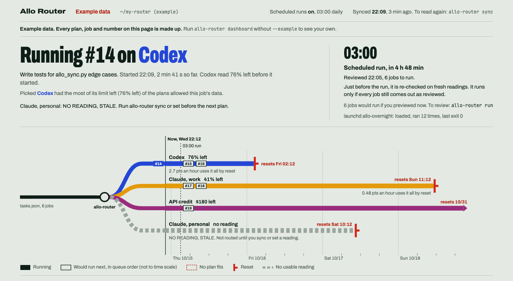

# Allo Router

The agent router for maximizing usage. Site: https://allorouter.com

You pay for several AI plans. Each has its own weekly limit and its own reset time. Some capacity goes unused while another plan runs dry. This tool tells you which plan should take which job before the next reset, and can then start those jobs for you.

**See it all on one page.** `allo-router dashboard` opens a page in your browser that shows which job is running and on which plan, what each plan has left before it resets, what runs next and whether your overnight run will accept its plan. It runs on your own computer: no login, no account, and nothing it shows leaves your machine. `allo-router dashboard --install-launcher` adds an Allo Dashboard you can double-click. [More below](#dashboard).

*Example data. Every plan, job and number in this screenshot is made up.*

It has five parts:
- The **planner** reads two JSON files you keep and prints a proposal. It never logs in to a plan, never starts a job, never sends anything and makes no network calls.
- **Sync** (`allo-router sync`) fills in how much of each plan is used from files Claude Code and Codex already keep on your computer, where they record it. Where a source gives no limit, it says so instead of guessing.
- The **executor** (`allo-router run`) previews that proposal and saves it as a plan file. `allo-router run --plan plan.json --execute` then runs exactly that reviewed plan through the CLI you configured for each pool, such as `claude -p` or `codex exec`, asking before each job. If anything changed since you reviewed it, it refuses and starts nothing.
- The **report** (`allo-router report`) reads the run log and summarizes what was routed where, what worked, what misrouted, the share of each plan's limit jobs actually used (measured, where it can be), and a separately labelled estimate of the usage saved. It is read-only.
- The **dashboard** (`allo-router dashboard`) opens a read-only page, served from your own computer, showing the same files live: what is running, what each plan has left, where each queued job would go, and whether the next scheduled run will accept its plan.

## Quickstart
Needs Python 3.9 or newer. No dependencies. Install with `pip install .` (or `uv tool install .`) from this folder (not on PyPI yet), or run `python3 allo.py` directly.

    mkdir my-router && cd my-router
    allo-router init                   # writes pools.json and tasks.json
    allo-router                        # prints the plan
    allo-router set chatgpt pct=55     # record a fresh reading by hand
    allo-router sync                   # or read it from local Claude Code / Codex files (pools with a "sync" block)
    allo-router run                    # preview: the exact command each job would run; saves plan.json
    allo-router run --plan plan.json --execute   # runs exactly that plan, asking before each job
    allo-router report --period week   # what ran, where, and what it saved (an estimate)
    allo-router dashboard              # opens a read-only page of all of the above in your browser
    allo-router dashboard --install-launcher   # adds an Allo Dashboard you can double-click

Without installing, replace `allo-router` with `python3 /path/to/allo.py`.

The starter files describe four example plans with made-up readings. Replace them with yours before trusting anything.

### Turning on a real backend
Every starter pool uses the `dry-run` backend, so a first `--execute` cannot start a real agent: it logs each job and starts nothing. Each starter pool also carries the command it would run, and the dry run prints it:

    #3  Refactor the pricing page  -> chatgpt (90% left)
        dry-run backend: nothing starts, even with --execute. With "backend": "shell" it would run: codex exec '...'

To opt a pool in, check that command against the CLI you have installed (a dry run marks a missing one `NOT FOUND`), then change that pool's `"backend": "dry-run"` to `"backend": "shell"` in `pools.json`:

    "run": {"backend": "shell", "command": ["codex", "exec", "{prompt}"]}

Opt in one pool at a time. Pools you leave on `dry-run` stay planned and logged but never start anything.

## What you put in
- `pools.json`: one entry per plan. Subscriptions carry `remaining_pct`. API credit carries `remaining_usd`. Each has `resets_at` (UTC) and the data `tiers` it may touch. A pool that should be runnable gets a `run` block (below).
- `tasks.json`: each job has a `tier`, a rough `est_usd`, whether it `needs` the `api`, a `priority`, and optionally the `prompt` to send (defaults to its `name`), a `cwd` to run in, and `"recurring": "daily"` or `"weekly"` for a job that should run once per UTC day or ISO week.

A `run` block names a backend:

    "run": {"backend": "shell", "command": ["claude", "-p", "{prompt}"], "timeout_s": 1800}
    "run": {"backend": "dry-run"}

`command` is a list, not a shell string: it is run directly, never through a shell, so nothing in a prompt can start another command. Items may use `{prompt}`, `{task_id}`, `{task_name}` and `{tier}`. Leave `{prompt}` out and the prompt is sent on stdin instead. `env` adds environment variables, `cwd` sets the working folder, relative to the config folder. Without one, jobs run in the config folder itself, not wherever you launched `allo-router`. Never put API keys or other secrets in `pools.json`; the CLI should already be logged in. The `dry-run` backend never starts anything, which is useful for a pool you want planned but not yet wired up. It accepts the same `command`, `env` and `cwd` as `shell` and only shows them, so switching to `shell` is a one-word change.

## Sync: readings from your own computer
A pool opts in with a `sync` block:

    "sync": {"source": "claude", "window": "week", "auto": true, "settle_s": 180}

`allo-router sync` reads every such pool (`--dry-run` to only print, `--pool ID` for one). With `"auto": true` the pool is also synced before `allo-router` prints a plan and before `allo-router run` previews one, never before a saved plan runs. `--no-sync` skips it for one command.

| source | % of plan limit and reset time | tokens |
|---|---|---|
| `claude` | Claude Code's own cache in `~/.claude.json` (`cachedUsageUtilization`, refreshed on Claude Code's own schedule, which can leave it days old), or the Claude Usage menu-bar app's `~/.claude/.statusline-usage-cache`, whichever is fresher | `~/.claude/projects/**/*.jsonl`, one count per API response |
| `codex` | the `rate_limits` Codex logs with every turn in `~/.codex/sessions` (5-hour and weekly windows, as your plan has them) | the same session files |

Each reading is labelled:
- **FULL**: the source gave the % of the plan limit used and when that window resets, and it has not reset since. Sync writes `remaining_pct = 100 - used`, `resets_at`, and `updated_at` = when the source took the reading (not when you synced), so an old source still shows STALE. A reading you typed in that is newer is kept.
- **PARTIAL**: tokens only, no limit. `remaining_pct` is left as it was. Tokens are never turned into a percentage.
- **UNAVAILABLE**: nothing usable, with the reason.

`window` picks which limit sets `remaining_pct` (`week` by default, or `5h`); both are recorded when the source has them. `home` points at another config folder; `"usage_app": false` ignores the Claude Usage app, which gets its numbers from claude.ai with your browser login (Allo Router only reads the file it leaves). These are undocumented local file formats: when one changes, sync reports UNAVAILABLE rather than a wrong number. Claude readings are whole percents.

## How it decides
- Pools are ranked by urgency: what is left divided by hours until reset.
- API jobs go to the credit pool while dollars fit above a reserve (default 10%). An API job never falls back to a subscription: if the credit pool is missing, unread, out of budget or not allowed the job's tier, it stays UNASSIGNED.
- Other jobs go to the subscription with the most known headroom (default at least 20%). Unknown readings are shown as unknown and never guessed.
- Data tiers are ordered, least sensitive first. A job can only go to a pool that lists its tier. Subscription plans can be capped at a lower tier with `subscription_max_tier`. Change the tier names in `pools.json`.
- Readings older than 24 hours are flagged STALE.
- Bad input stops the planner with a message instead of a guess: a timestamp without a zone (`2026-10-16T20:00:00` instead of `...Z`), a negative `est_usd`, a task or pool tier missing from `tiers`, an unknown `set` key (`set chatgpt percent=55`) or a non-number for `pct=`/`usd=`. `init` writes nothing if either file already exists, and a missing `pools.json` or `tasks.json` points you to `init` or `--dir`.

## Preview, review, run
`run` never plans and executes in one step. The preview is what you approve, and `--execute` only accepts a saved preview:

1. `allo-router run` prints every job, its pool and the exact command, starts nothing, and saves the plan to `plan.json` in the config folder (`--save-plan FILE` to put it elsewhere). It prints the command to run it next.
2. Read it. `allo-router run --plan plan.json` re-checks a saved plan against your files without starting anything.
3. `allo-router run --plan plan.json --execute` runs the jobs that were runnable in that plan, in its order, and nothing else.

The plan file records when it was made, a fingerprint of the readings (`remaining_pct`, `remaining_usd`, `resets_at`, `updated_at`, `source` of every pool), a hash of the rest of `pools.json` and `tasks.json`, each job's pool, prompt, folder and command, and a hash of all of that. `--execute` refuses, with exit code 2 and before starting any job, when:
- the plan file was edited after it was saved (its hash no longer matches),
- it is older than `--max-plan-age` minutes (default 60) or dated in the future,
- it was saved for another config folder,
- readings changed since (for example you ran `allo-router set`), or anything else in `pools.json` or `tasks.json` changed,
- a reviewed job would now come out differently: another pool, prompt, folder or command, or a skip such as a reading that has since gone STALE.

Fix the cause and preview again. A job that finished ok after the plan was saved, or under the same plan, is skipped rather than run twice. `--only`, `--allow-unverified` and `--rerun` shape the plan, so they go on the preview, not on `--plan`.

The hash catches accidental edits and drift. It is not a signature: anyone who can write the plan file can also write `pools.json`. Plan files hold your prompts; `plan.json` is gitignored.

## What `run` will not do
- Start anything without `--execute`, and execute anything but a saved plan that still matches (above). Without a terminal to ask you, it also needs `--yes`.
- Run a job on a pool that has no `run` block. Those jobs stay yours to start.
- Run on a pool flagged STALE, NO READING, NO RESET TIME or RESET PASSED. Record a fresh reading with `allo-router set`, or preview with `--allow-unverified`.
- Run a job that already finished ok (per `runs.jsonl`) unless you preview with `--rerun`. A job counts as finished by its task `id` and `name`, not its prompt, so rewording a finished job's `prompt` does not run it again. To run it with the new prompt, preview with `--rerun --only <id>`, or add it as a new task. A `recurring` task counts as finished for the current UTC day or ISO week only.
- Pass a prompt that starts with `-` where the CLI would read it as an option. Put `"--"` before `{prompt}` in `command` if your CLI supports it.
- Update your readings. `pools.json` and `tasks.json` are never edited. For a pool with a `sync` block it reads usage just before and after each job and logs both to `runs.jsonl` with the share of the limit used (below); run `allo-router sync` before the next plan. Each job's output goes to `runs/` and a one-line record to `runs.jsonl`. Under `--execute`, a job that is skipped also gets a line (status `skipped`, with the reason), so the report can show it.

Other flags: `--only 1,3` limits the preview to those task ids. `allo-router run --help` lists them all.

### Scheduled runs: `--refresh`
A plan you review in the evening is older than `--max-plan-age` by an overnight run. `allo-router run --refresh plan.json` re-checks it shortly before the run on fresh readings (it auto-syncs first, like a preview) and saves it again only if `pools.json` apart from readings and `tasks.json` are as reviewed, the review is at most `--max-review-age` minutes old (default 960, counted from the review, not the last refresh), and every job reviewed as runnable comes out with the same pool, prompt, folder and command. A job that finished since is skipped; a job reviewed as skipped stays skipped. Otherwise it saves nothing and exits 2. It starts nothing. `--save-plan FILE` writes the copy elsewhere. The refreshed plan records `reviewed_at` and `reviewed_plan`. [examples/launchd/](examples/launchd/) has a launchd job that runs refresh, then execute.

## Report
`allo-router report` turns `runs.jsonl` into a markdown summary on stdout. It starts nothing and changes no file except the CSV you ask for.

    allo-router report                                  # everything logged so far
    allo-router report --period week                    # one row per ISO week (or --period day)
    allo-router report --since 2026-10-01 --until 2026-10-14   # UTC; a bare --until date includes that whole day
    allo-router report --csv runs.csv > report.md       # also one CSV row per job

It shows, per period: jobs logged and routed, how many ran, succeeded, failed or were skipped, run time, and usage where the CLI reported it. Per job: pool, backend, status, duration, reported usage and whether the pool's reading was fresh when it ran.

**Plan used (MEASURED).** For jobs on a pool with a `sync` block, the report shows the plan's own usage reading before and after each job and the difference, in percentage points of that window's limit, plus the tokens the CLI reported. It is shown only when both readings are FULL, cover the same window (no reset in between) and the after reading was taken after the job ended; otherwise the row says why not. Set `settle_s` so the executor waits for the source to refresh (the Claude Usage app refreshes every few minutes; Codex logs a reading with each turn). The difference is account-wide: any other use of the same plan between the two readings is in it. Claude reports whole percents, so a small job often reads 0 pts.

**Tokens.** When a CLI prints its own usage as JSON, the executor keeps it: `claude -p --output-format json` reports a cost (API list price, even on a subscription) and tokens, `codex exec --json` reports tokens. With plain-text output the report says `not reported`.

**Misroutes** are jobs that failed or timed out, ran on a pool whose reading was flagged (via `--allow-unverified`), or were skipped because no pool fit, the pool needed a fresh reading, the run block was bad or the working folder was missing. A skip because the job already ran, its pool has no run block, or you said no is listed but is not a misroute.

**Usage saved is an ESTIMATE**, labelled as one, with the method printed in every report:
- Each job that ran gets a cost basis: the CLI-reported cost, else the task's `est_usd`. Jobs with neither are left out and counted.
- Each pool gets a price factor: `credit_usd` 1.0 (you pay API prices), `subscription` 0.0 (already paid for; the planner only routes to a plan with headroom, so the job uses capacity that expires at reset otherwise). Change one with `--price claude_work=0.2`.
- The baseline is the same jobs at one factor: `--baseline api` (default, every job at API price), `--baseline max` (every job on the priciest pool) or `--baseline <pool id>`.
- Est. saved = cost basis x (baseline factor - factor of the pool the job ran on), summed. It ignores whether the job would have fit on the baseline pool. How much of a plan's limit was used is the measured section above, never this estimate.

Logs written by 0.2.0 lack skips, reading flags and usage; the report shows those fields as `not recorded`.

## Dashboard
Every Allo Router install has it. Open it either way:
- **Command:** `allo-router dashboard` in your config folder (or `allo-router --dir ~/my-router dashboard`). It serves the page on http://127.0.0.1:8765 and opens it in your browser. `--port` picks another port, `--no-open` only serves it. Ctrl-C stops it. Run it again while it is running and it opens the running one.
- **Launcher:** run `allo-router dashboard --install-launcher` once in your config folder. On macOS it writes `~/Applications/Allo Dashboard.command` and `Allo Dashboard.app` (find it with Spotlight or drag it to the Dock); on Linux, `~/.local/share/applications/allo-dashboard.desktop`, in your applications menu. Double-click it: a terminal window starts the dashboard and your browser opens it. Close the window to stop it. Run the command again after moving the folder or reinstalling Allo Router somewhere else.

It runs entirely on your computer. There is no login and no account, and nothing it shows leaves your machine: the server listens on 127.0.0.1 only, and the page loads nothing from anywhere else (fonts are served by the same local server).

It shows:
- whether a job is running (from `runs/current.json`, which the executor writes while a job runs, checked against its process) and why that plan was picked,
- each plan's reading, flags and reset on one time axis, with the jobs that would run next on each plan,
- the saved `plan.json`: when it was reviewed, whether it still matches, and whether the next scheduled run will accept it,
- launchd agents in `~/Library/LaunchAgents` that run `allo-router` on this folder: their next run, whether they are loaded (`launchctl print`), and the last outcome in their log,
- today's jobs with plan, result, time, measured plan use and tokens, and this week's counts, misroutes, measured use per plan and the estimated saving.

It is read-only: it never syncs, never starts a job and never loads or unloads a launchd agent. It answers GET only and refuses requests whose `Host` is not this computer, so a web page elsewhere cannot read it through your browser. Anything else running on this computer can reach 127.0.0.1:8765 while it is open, and the page shows your prompts and commands; it does not run unless you start it. `--json` prints the data and exits. `--example` serves made-up data, labelled "Example data" on the page. It refreshes every 15 seconds.

## What it does not do
- It does not contact any provider for usage. `sync` reads only files on your computer, and only where those files hold a limit does it record a percentage. Those formats are undocumented and may change; when they do, sync says UNAVAILABLE and you type the numbers in with `set`.
- It does not check whether a provider's terms allow a given use of your plan, including running a CLI non-interactively. That is yours to read.
- Cost estimates are your guesses. The planner does not measure them.
- No built-in scheduler. A reviewed plan can be run from launchd or cron with `run --refresh` then `run --plan ... --execute --yes` ([examples/launchd/](examples/launchd/)); a person still reviews each plan. See [docs/roadmap.md](docs/roadmap.md).

## More
- [CHANGELOG.md](CHANGELOG.md): what changed in each version. This is 0.4.0; `allo-router --version` prints it.
- [docs/architecture.md](docs/architecture.md): how the planner, sync, executor and report fit together, and how to write a backend.
- [docs/roadmap.md](docs/roadmap.md): what is next.
- [examples/](examples/): the starter config and a custom backend.

## Tests
    pip install pytest
    python3 -m pytest tests

or, with uv and no install: `uvx --python 3.12 pytest -q tests`.

Tests never use the network: a fixture blocks sockets, and the shell backend is exercised with small local Python commands.
